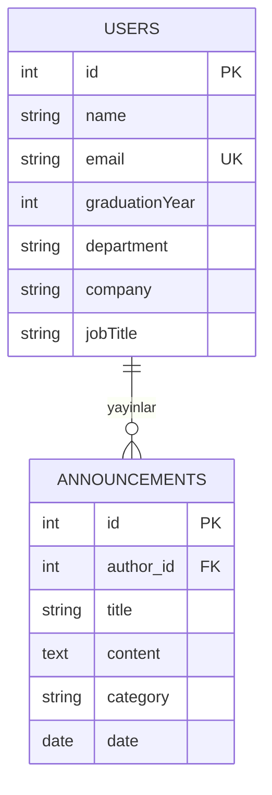

# 📐 Data Design Documentation (DDD)
> **Alumni Tracking System (Mezun Takip Sistemi) — Veri Tasarımı & Modelleme Kılavuzu**

Bu doküman, sistemin veri mimarisini, modellerini, alan kısıtlarını, ilişkilerini ve gelecekte bağlanacak kalıcı veritabanı (RDBMS / Docker Volume) için veri sözlüğünü (Data Dictionary) tanımlar.

---

## 🎯 1. Veri Tasarımının Amacı ve Felsefesi
Bu proje, **"The Forgetting Test"** deneyimi sonrasında bellek içi (In-Memory / RAM) geçici yapılardan kalıcı veritabanı mimarisine geçiş sürecindedir. 

MVC mimarisinde **Model** katmanı tek bir kural merkezidir (*"One rule, one place"*). Veritabanı bağlandığında Controller veya View katmanlarına dokunulmadan, yalnızca Model katmanı bu dokümanda tanımlanan şemaya göre kalıcı depolama ile entegre edilecektir.

---

## 🏛️ 2. Veri Modelleri ve Alan Tanımları (Data Dictionary)

Sistem şu an iki ana varlık (Entity) üzerinden modellenmektedir:

### 👤 2.1. `User` (Kullanıcı / Mezun Modeli)
Sistemdeki mezunların, öğrencilerin veya sistem yöneticilerinin temel profil verilerini temsil eder.

| Alan Adı (Field) | Veri Tipi | Zorunlu mu? | Varsayılan | Kısıt / Doğrulama Kuralı | Açıklama |
| :--- | :--- | :---: | :---: | :--- | :--- |
| `id` | `INTEGER` | Evet | Otomatik Artan (PK) | Benzersiz, pozitif tam sayı | Kaydın tekil kimliği |
| `name` | `VARCHAR(100)` | Evet | - | Boş olamaz, min 2 karakter | Kullanıcının ad ve soyadı |
| `email` | `VARCHAR(255)` | **Evet (Zorunlu)** | - | Geçerli e-posta formatı, Benzersiz (Unique) | İletişim & giriş adresi (Model kuralı: eksikse 400) |
| `graduationYear` | `INTEGER` | Hayır | `NULL` | 1950 - 2030 arası tam sayı | Mezun olunan yıl |
| `department` | `VARCHAR(150)` | Hayır | "YBS" | Maks 150 karakter | Mezun olunan bölüm |
| `company` | `VARCHAR(150)` | Hayır | `NULL` | - | Halihazırda çalışılan şirket |
| `jobTitle` | `VARCHAR(150)` | Hayır | `NULL` | - | Mevcut görev / pozisyon unvanı |
| `skills` | `JSON / ARRAY` | Hayır | `[]` | Dizi formatında metinler | Yetkinlikler (Örn: Node.js, SQL) |

---

### 📢 2.2. `Announcement` (Duyuru Modeli)
Mezunlar Ofisi veya Kariyer Merkezi tarafından paylaşılan etkinlik, iş ve buluşma duyurularını temsil eder.

| Alan Adı (Field) | Veri Tipi | Zorunlu mu? | Varsayılan | Kısıt / Doğrulama Kuralı | Açıklama |
| :--- | :--- | :---: | :---: | :--- | :--- |
| `id` | `INTEGER` | Evet | Otomatik Artan (PK) | Benzersiz, pozitif tam sayı | Duyurunun tekil kimliği |
| `title` | `VARCHAR(200)` | **Evet (Zorunlu)** | - | Boş olamaz, min 3 karakter | Duyuru başlığı |
| `content` | `TEXT` | **Evet (Zorunlu)** | - | Boş olamaz | Duyurunun detaylı açıklaması |
| `category` | `VARCHAR(50)` | Evet | "Genel" | `Genel`, `Kariyer`, `Etkinlik`, `Buluşma` | Duyuru kategorisi |
| `author` | `VARCHAR(100)` | Evet | "Mezunlar Ofisi" | Boş olamaz | Duyuruyu yayınlayan birim |
| `date` | `DATE` | Evet | Bugünün tarihi | `YYYY-MM-DD` | Yayınlanma tarihi |

---

## 🔗 3. Varlık İlişki Diyagramı (Entity Relationship Diagram - ERD)

Gelecekte bağlanacak veritabanında varlıkların birbiriyle olan ilişkisi:

---

## 💾 4. Kalıcılık Stratejisi (Persistence & "Forgetting Test" Çözümü)

Şu anki geliştirme aşamasında veriler bellek içi (In-Memory RAM) olarak tutulmaktadır:
* `let users = [...]` (`models/userModel.js`)
* `let announcements = [...]` (`models/announcementModel.js`)

### 🐳 Kalıcı Veritabanı Geçiş Planı (Next Steps):
1. **RDBMS Seçimi:** İlişkisel veri yapısı, yabancı anahtar (FK) bütünlüğü ve ACID güvencesi nedeniyle **PostgreSQL** veya **MySQL** kullanılacaktır.
2. **Docker Compose & Volume Entegrasyonu:**
   * Veritabanı servisi konteyner olarak ayağa kaldırılacak.
   * `volumes: - db_data:/var/lib/postgresql/data` tanımlanarak sunucu veya konteyner kapansa dahi (`docker compose down`) verilerin diske yazılması garanti altına alınacaktır.
3. **ORM / Query Builder:** Model katmanındaki `findAll()`, `create()` gibi CRUD fonksiyonları SQL sorguları veya hafif bir ORM ile kalıcı veritabanına bağlanacaktır.
