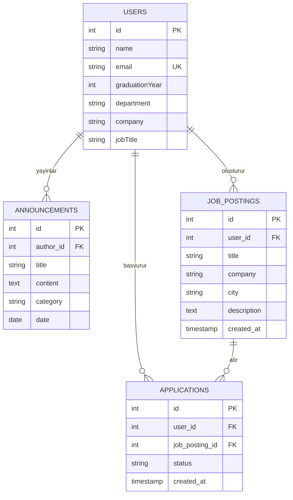

# 📐 Data Design Documentation (DDD)
> **Alumni Tracking System (Mezun Takip Sistemi) — Veri Tasarımı & Modelleme Kılavuzu**

Bu doküman, sistemin veri mimarisini, modellerini, alan kısıtlarını, ilişkilerini ve gelecekte bağlanacak kalıcı veritabanı (RDBMS / Docker Volume) için veri sözlüğünü (Data Dictionary) tanımlar.

---

## 🎯 1. Veri Tasarımının Amacı ve Felsefesi
Bu proje, **"The Forgetting Test"** deneyimi sonrasında bellek içi (In-Memory / RAM) geçici yapılardan kalıcı veritabanı mimarisine geçiş sürecindedir. 

MVC mimarisinde **Model** katmanı tek bir kural merkezidir (*"One rule, one place"*). Veritabanı bağlandığında Controller veya View katmanlarına dokunulmadan, yalnızca Model katmanı bu dokümanda tanımlanan şemaya göre kalıcı depolama ile entegre edilecektir.

---

## 🏛️ 2. Veri Modelleri ve Alan Tanımları (Data Dictionary)

Sistem şu an dört ana varlık (Entity) üzerinden modellenmektedir:

### 👤 2.1. `User` (Kullanıcı / Mezun Modeli)
Sistemdeki mezunların, öğrencilerin veya sistem yöneticilerinin temel profil verilerini temsil eder.

| Alan Adı (Field) | Veri Tipi | Zorunlu mu? | Varsayılan | Kısıt / Doğrulama Kuralı | Açıklama |
| :--- | :--- | :---: | :---: | :--- | :--- |
| `id` | `INTEGER` | Evet | Otomatik Artan (PK) | Benzersiz, pozitif tam sayı | Kaydın tekil kimliği |
| `name` | `VARCHAR(100)` | Evet | - | Boş olamaz, min 2 karakter | Kullanıcının ad ve soyadı |
| `email` | `VARCHAR(255)` | **Evet (Zorunlu)** | - | Geçerli e-posta formatı, Benzersiz (Unique) | İletişim & giriş adresi (Model kuralı: eksikse 400) |
| `graduationYear` | `INTEGER` | Hayır | `NULL` | 1950 - 2030 arası tam sayı | Mezun olunan yıl |
| `department` | `VARCHAR(150)` | Hayır | "YBS" | Maks 150 karakter | Mezun olunan bölüm |
| `company` | `VARCHAR(150)` | Hayır | `NULL` | - | Halihazırda çalışılan şirket |
| `jobTitle` | `VARCHAR(150)` | Hayır | `NULL` | - | Mevcut görev / pozisyon unvanı |
| `skills` | `JSON / ARRAY` | Hayır | `[]` | Dizi formatında metinler | Yetkinlikler (Örn: Node.js, SQL) |

---

### 📢 2.2. `Announcement` (Duyuru Modeli)
Mezunlar Ofisi veya Kariyer Merkezi tarafından paylaşılan etkinlik, iş ve buluşma duyurularını temsil eder.

| Alan Adı (Field) | Veri Tipi | Zorunlu mu? | Varsayılan | Kısıt / Doğrulama Kuralı | Açıklama |
| :--- | :--- | :---: | :---: | :--- | :--- |
| `id` | `INTEGER` | Evet | Otomatik Artan (PK) | Benzersiz, pozitif tam sayı | Duyurunun tekil kimliği |
| `title` | `VARCHAR(200)` | **Evet (Zorunlu)** | - | Boş olamaz, min 3 karakter | Duyuru başlığı |
| `content` | `TEXT` | **Evet (Zorunlu)** | - | Boş olamaz | Duyurunun detaylı açıklaması |
| `category` | `VARCHAR(50)` | Evet | "Genel" | `Genel`, `Kariyer`, `Etkinlik`, `Buluşma` | Duyuru kategorisi |
| `author` | `VARCHAR(100)` | Evet | "Mezunlar Ofisi" | Boş olamaz | Duyuruyu yayınlayan birim |
| `date` | `DATE` | Evet | Bugünün tarihi | `YYYY-MM-DD` | Yayınlanma tarihi |

---

### 💼 2.3. `JobPosting` (İş İlanı Modeli - `job_postings`)
Mezun veya işveren kullanıcılar tarafından açılan kariyer ve staj ilanlarını temsil eder. Her ilan kesinlikle tek bir kullanıcıya aittir (**One-to-Many**).

| Alan Adı (Field) | Veri Tipi | Zorunlu mu? | Varsayılan | Kısıt / Doğrulama Kuralı | Açıklama |
| :--- | :--- | :---: | :---: | :--- | :--- |
| `id` | `INTEGER` | Evet | Otomatik Artan (PK) | Benzersiz, pozitif tam sayı | İlanın tekil kimliği |
| `user_id` | `INTEGER` | **Evet (Zorunlu)** | - | `FK -> users.id`, pozitif tam sayı olmalı (yoksa 404) | İlanı oluşturan kullanıcının kimliği (URL'den `:id` ile gelir) |
| `title` | `VARCHAR(120)` | **Evet (Zorunlu)** | - | String, boş olamaz (`trim`), min 2 / **maks 120 karakter** | Pozisyon başlığı (Örn: "Junior Developer") |
| `company` | `VARCHAR(150)` | **Evet (Zorunlu)** | - | String, boş olamaz (`trim`), min 2 / maks 150 karakter | Şirket / Kurum adı (Örn: "Acme") |
| `city` *(veya `location`)* | `VARCHAR(100)` | Hayır *(Opsiyonel)* | `NULL` / "İstanbul (Hibrit)" | Gönderilirse string olmalı, maks 100 karakter | İlanın bulunduğu şehir / çalışma lokasyonu |
| `description` | `TEXT` | Hayır *(Opsiyonel)* | `NULL` | Gönderilirse string olmalı, maks 2000 karakter | İlan detayları ve gereksinimler |
| `created_at` | `TIMESTAMP` | Evet | `CURRENT_TIMESTAMP` | - | İlanın sisteme girildiği tarih/saat |

#### 📏 `JobPosting` Doğrulama Kuralları (Validation Rules):
1. **`title` (Zorunlu):** İstek gövdesinde mutlaka bulunmalıdır, metin (`string`) tipinde olmalı, yalnızca boşluk karakterlerinden oluşamaz (`trim()` sonrası min 2 karakter) ve **en fazla 120 karakter** olabilir.
2. **`company` (Zorunlu):** İstek gövdesinde mutlaka bulunmalıdır, metin (`string`) tipinde olmalı, boşluklar temizlendikten sonra en az 2, en fazla 150 karakter olmalıdır.
3. **`city` / `location` (Opsiyonel):** Gönderilmek zorunda değildir; ancak gönderilirse metin (`string`) tipinde ve en fazla 100 karakter olmalıdır.
4. **`description` (Opsiyonel):** Gönderilmek zorunda değildir; ancak gönderilirse metin (`string`) tipinde ve aşırı uzun veri/spam önlemi olarak en fazla 2000 karakter olmalıdır.
5. **`user_id` (İlişki & Yol Parametresi Kuralı):** URL'den gelen `:id` değeri geçerli bir pozitif tam sayı olmalıdır (değilse `400`), ayrıca `users` tablosunda karşılığı yoksa ilan oluşturulamaz (`404 Not Found`).

#### 🗑️ Silme Kuralı Kararı (The Delete Rule Decision):
* **Seçilen Kural:** `CASCADE` (veya alternatif olarak `RESTRICT`).
* **Karar & Gerekçe:** Sistemde bir kullanıcı hesabı silindiğinde (`DELETE /api/users/:id`), o kullanıcının açtığı iş ilanlarının veritabanında sahipsiz (yetim / orphaned) kalmaması için ilişkili ilanlar da otomatik olarak silinir (`ON DELETE CASCADE`). İlanların korunması istenirse silme işlemi engellenerek `RESTRICT` ile `409 Conflict` dönülebilir; bu mimaride kullanıcı ile açtığı ilanlar doğrudan bağlantılı kabul edilmiştir.

---

### 📝 2.4. `Application` (İş Başvurusu Modeli - `applications`)
Kullanıcılar ile iş ilanları arasındaki **Many-to-Many (Çoka-Çok)** ilişkiyi kuran ara tablodur (Join Table). Her satır tek bir kullanıcı-ilan eşleşmesini temsil eder.

| Alan Adı (Field) | Veri Tipi | Zorunlu mu? | Varsayılan | Kısıt / Doğrulama Kuralı | Açıklama |
| :--- | :--- | :---: | :---: | :--- | :--- |
| `id` | `INTEGER` | Evet | Otomatik Artan (PK) | Benzersiz, pozitif tam sayı | Başvurunun tekil kimliği |
| `user_id` | `INTEGER` | **Evet (Zorunlu)** | - | `FK -> users.id` | Başvuran kullanıcının kimliği |
| `job_posting_id` | `INTEGER` | **Evet (Zorunlu)** | - | `FK -> job_postings.id` | Başvurulan iş ilanının kimliği |
| `status` | `VARCHAR(50)` | Evet | "applied" | `applied`, `interview`, `accepted`, `rejected` | Başvuru süreci durumu |
| `created_at` | `TIMESTAMP` | Evet | `CURRENT_TIMESTAMP` | - | Başvuru tarihi/saati |

#### 🛡️ Mükerrer Başvuru Kısıtı (Unique Pair Constraint):
* **Kural:** `UNIQUE (user_id, job_posting_id)`
* **Karar & Gerekçe:** Bir kullanıcı aynı ilana birden fazla kez başvuramaz. Aynı çift tekrar gönderilmeye çalışıldığında veritabanı isteği reddeder ve API katmanı **`409 Conflict`** yanıtı döner.

---

## 🔗 3. Varlık İlişki Diyagramı (Entity Relationship Diagram - ERD)

Gelecekte bağlanacak veritabanında varlıkların birbiriyle olan ilişkisi:

---

## 💾 4. Kalıcılık Stratejisi (Persistence & "Forgetting Test" Çözümü)

Şu anki geliştirme aşamasında veriler bellek içi (In-Memory RAM) olarak tutulmaktadır:
* `let users = [...]` (`models/userModel.js`)
* `let announcements = [...]` (`models/announcementModel.js`)
* `let jobPostings = [...]` (`models/jobPostingModel.js`)
* `let applications = [...]` (`models/applicationModel.js`)

### 🐳 Kalıcı Veritabanı Geçiş Planı (Next Steps):
1. **RDBMS Seçimi:** İlişkisel veri yapısı, yabancı anahtar (FK) bütünlüğü ve ACID güvencesi nedeniyle **PostgreSQL** veya **MySQL** kullanılacaktır.
2. **Docker Compose & Volume Entegrasyonu:**
   * Veritabanı servisi konteyner olarak ayağa kaldırılacak.
   * `volumes: - db_data:/var/lib/postgresql/data` tanımlanarak sunucu veya konteyner kapansa dahi (`docker compose down`) verilerin diske yazılması garanti altına alınacaktır.
3. **ORM / Query Builder:** Model katmanındaki `findAll()`, `create()` gibi CRUD fonksiyonları SQL sorguları veya hafif bir ORM ile kalıcı veritabanına bağlanacaktır.

---

## 🛡️ 5. Doğrulama, Hata Yönetimi ve Loglama Kuralları (Middleware Sözleşmesi)

1. **Doğrulama & İş Kuralları (`400 Bad Request` / `409 Conflict`):**
   * `User.email`, `Announcement.title` & `content`, `JobPosting.title` (maks 120 karakter) & `company` alanları zorunludur; eksiklik veya bozuk JSON (`SyntaxError`) durumunda `400` dönülür.
   * `Application` tablosunda `(user_id, job_posting_id)` ikilisi benzersizdir; mükerrer başvuruda **`409 Conflict`** dönülür.
2. **404 Guardian & Yönlendirme (`404 Not Found`):**
   * API isteklerinde tanımlanmamış rota, eksik `:id` veya yanlış metot hataları gerekçeli (`reason`) JSON olarak döner.
   * Tarayıcı üzerinden gelen geçersiz web sayfaları genel [`public/404.html`](public/404.html) (`/404`) sayfasına yönlendirilir.
3. **5xx Guardian & Kalıcı Loglama (`logs/error.logs`):**
   * Beklenmeyen tüm `5xx` hataları tek merkezde (`middleware/errorMiddleware.js`) yakalanır; güvenlik gereği `err.stack` istemciye **gönderilmez**, yalnızca sunucu terminaline ve [`logs/error.logs`](logs/error.logs) dosyasına yazılır.
   * Tüm `4xx` ve `5xx` olayları zaman damgası ve gerekçeleriyle [`logs/error.logs`](logs/error.logs) dosyasında saklanır.
